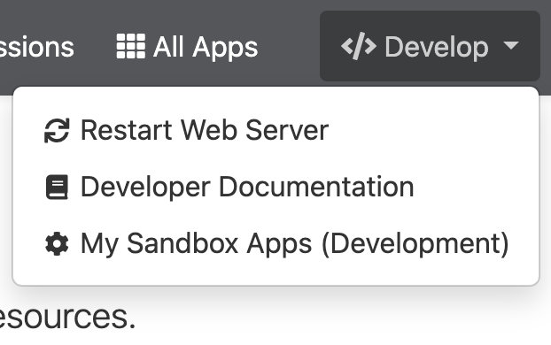

# Open OnDemand Contributor Guide
## Set up your development environment
We introduce two simple ways to set up your OOD development environment: set up a sandbox and set up an OOD Docker container.  
### Set up a sandbox for app development
If you have access to an Open OnDemand portal, the easiest way to set up your development environment is to open a sandbox. 

**Note:** Before you can use the OOD sandbox development environment, it must be enabled by the OOD administrator. This mode allows you to create and test custom web applications directly from your home directory in an isolated space. Contact your OOD adminstrator if you don't see the "Develop" menu after step 1.  

1. Create the Development Folder: If you don't see the "Develop" menu in your dashboard, you typically need to create a specific directory in your terminal to signal the system:

```{bash}
mkdir -p ~/ondemand/dev
```

2. Open the Dashboard: Log in to the Open OnDemand portal.

3. Navigate to Sandbox: In the top navigation bar, click the "Develop" menu and select "My Sandbox Apps (Development)".



4. Launch Your App: From this page, you can see a list of applications currently in your ~/ondemand/dev folder. Click Launch next to an app to start its session in a new tab.

### Set up an OOD Docker container for app development

Follow the instructions in this [link](https://github.com/OSC/ood-demo) to set up a docker container for app development. 

## Initializers

Open OnDemand Dashboard initializers are Ruby files located in `/etc/ood/config/apps/dashboard/initializers`. 
They are loaded when the Dashboard starts and provide a convenient way to customize or 
extend Dashboard behavior without modifying the Open OnDemand source code. Initializers can be used to change 
application settings, add site-specific logic, or customize how Dashboard features are initialized.

Why use an initializer instead of embedding code in each app form?
* App-form approach: If you embed user attribute-capturing code directly into each individual app form, that code executes in each app every time the user visits any app or refreshes any OOD page. This creates redundant processing across your applications.
* Initializer approach: With an initializer, the attribute-capturing code runs only once, at the moment the user logs into Open OnDemand. The initializer will re-execute if a user returns to any Open OnDemand page after 5 minutes of inactivity, as their PUN (Privileged User Namespace) session expires at that point.

Let's see a few examples below.

### Add user specified paths to Files 
As the OOD Administrator, create a file `/etc/ood/config/apps/dashboard/initializers/user_paths.rb` with the following code:

```{ruby}
Rails.application.config.after_initialize do
  OodFilesApp.candidate_favorite_paths.tap do |paths|
    user = User.new.name
    fav_path = File.join(Dir.home(user), "ondemand", "favorite_path.txt")

    if File.file?(fav_path)
      File.foreach(fav_path) do |line|
        path = line.strip
        paths << FavoritePath.new(path) unless path.empty?
      end
    end
  end
end
```

Once the file is in place, users can add any paths they would like to list under `Files` 
as follows:
1. Add the paths to `$HOME/ondemand/favorite_path.txt`, one path per line.
2. Restart their PUN by clicking `Develop`->`Restart Web Server`. 

### Display user projects in form.yml.erb
1. Add an initializer that captures the output of a command that lists a user's projects, one project per line.

```{ruby}
# /etc/ood/config/apps/dashboard/initializers/user_attributes.rb  (root owned)

require 'open3'

module OodSupport
  class User
    def myprojects
      @myprojects ||= begin
        # the custom myproject command below returns a list of a user's projects, one per line
        cmd = "/sw/local/bin/myproject"
        o, e, s = Open3.capture3(cmd)
        o.chomp.split
      end
    end
  end
end
```

2. Display user accounts in a form.yml.erb app file
```
# /var/www/ood/apps/sys/jupyter/form.yml.erb

projects:
    widget: 'select'
    label: 'Project'
    options:
        <%  OodSupport::User.new.myprojects.each do |line| %>
        - "<%= line %>"
        <%- end %>
```   
### Predefined initializers
There are several automatic predefined [attributes](https://osc.github.io/ood-documentation/latest/how-tos/app-development/interactive/form.html#automatic-predefined-attributes) that dynamically populate form fields with system values such as clusters, queues, accounts, and software modules. Simply add the attribute name to the form: list in your form.yml.erb file.
```{ruby}
# /var/www/ood/apps/sys/myapp/form.yml.erb

form:
  - auto_accounts
  - auto_queues
  - auto_qos
  - auto_batch_clusters
  - auto_cores
  - auto_groups
  - auto_primary_group
  - auto_modules_<modulename>
```

## Global form items
Global batch connect form items can be used (v4.0+) to display a common field in all batch connect applications.

### Define global form item
As an example, lets add a field that allows the user to input a specific compute node name adding a pattern validation to match node names and disabling caching.
```{ruby}
# /etc/ood/config/ondemand.d/global_bc_items.yml.erb  (root owned)

global_bc_form_items:
  global_node_name:
    widget: 'text_field'
    label: "Node Name"
    pattern: "^cpu[0-9]{3}$"
    cacheable: false
```
Add the global_node_name to any forms you want to display the field.
```{ruby}
# /var/www/ood/apps/sys/myapp/form.yml.erb

form:
  - global_node_name
```

### Add initializers in global form items
Due to the order in which files are read, a subclass file will need to be created in order to use initializers in global form items.
1. add the initializer in a subclass file (root owned).
```{ruby}
# /etc/ood/config/apps/dashboard/initializers/init4globals.rb

require 'ood_support'

class MyUser < OodSupport::User
  def myprojects
      @myprojects ||= begin
        # the custom myproject command below returns a list of a user's projects, one per line
        cmd = "/sw/local/bin/myproject"
        o, e, s = Open3.capture3(cmd)
        o.chomp.split
      end
  end
end
```
2. Add a line in the global_bc_items.yml.erb file to include the subclass file and define the global_project form item.
```{ruby}
# /etc/ood/config/ondemand.d/global_bc_items.yml.erb

<% require '/etc/ood/config/apps/dashboard/initializers/init4globals.rb' %>

global_bc_form_items:
  global_project:
    label: 'Project'
    widget: 'select'
    options:
        <%  MyUser.new.myprojects.each do |line| %>
        - "<%= line %>"
        <%- end %>
```
3. Add the global_project to any app forms where you want to display the field.
```{ruby}
# /var/www/ood/apps/sys/myapp/form.yml.erb

form:
  - global_project
```

> [!TIP] 
> The filename can affect load order because the files are evaluated alphabetically. 
> Use numeric prefixes such as `10_user_paths.rb`, `20_...` if order matters.

